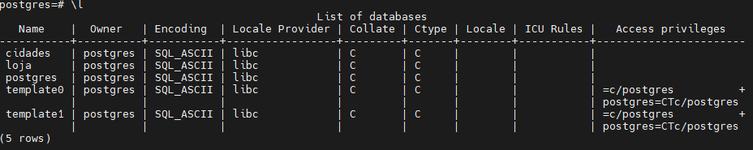

# Atividade 1 Aula 04 - Criação e edição do primeiro banco de dados

## 1° passo: Criem um novo banco de dados "cidades"

## 2° passo: Criar uma tabela chamada "maiorescidades" e Adicionar como, colunas: id, nome, populacao

## 3° passo: Inserir registros das 5 maiores cidades do mundo 

## 4° passo: Consultar os 5 registros
