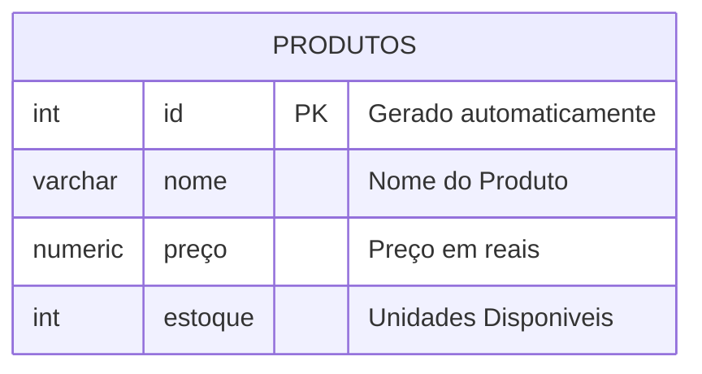

## Aula 04
Comando para apagar um banco de dados:

```sql
DROP DATABASE lojamax;
```

---
O objetivo é criar uma loja para aprender os principais comandos SQL.



PARA CRIAR A TABELA UTILIZAMOS OS COMANDOS A BAIXO:

CREATE TABLE produtos(
    id INT GENERATED ALWAYS AS
    IDENTITY PRIMARY KEY,
    nome VARCHAR(50) NOT NULL,
    preco NUMERIC(10,2) NOT NULL,
    estoque INT NOT NULL DEFAULT 0
);

iNSERINDO VALORES 

-- INSERT INTO produtos(nome,preco,estoque)
-- VALUES('IPHONE 17','10000.00','15');

### Criação do primeiro banco de dados CIDADES.


