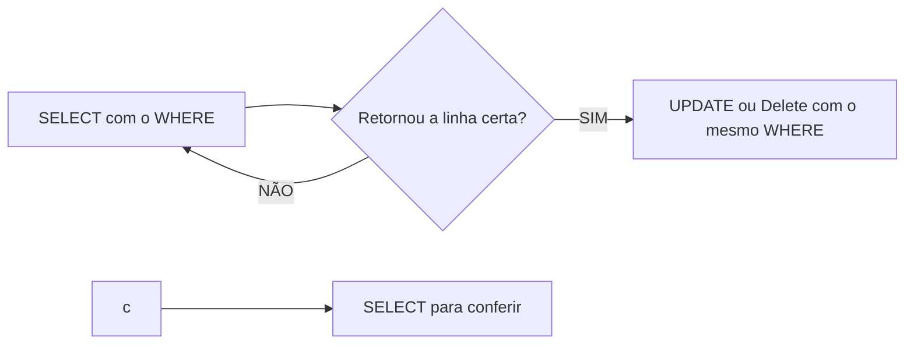

## Aula 05 
Para filtrar colunas utilizamos o comando:
```sql
SELECT nome,população FROM produtos;
```

Para filtros de registros, utilizamos o comando:

```sql
SELECT * FROM produtos WHERE estoque < 10;
```

- Exemplo:
```sql
SELECT nome,população FROM maiorescidades ORDER BY populacao DESC;
```


---
> **update:** update ou delete sem `WHERE` atinge todas as linhas!!! (Não existe CTRL + Z).
---

> Fluxo seguro (sempre):

Também é ´possivel realizar calculos:
```sql
UPDATE maiorescidades
SET populacao = populacao - 20
WHERE id = 2;
```

COMANDOS UTILIZADOS 

-- CREATE TABLE filmeseseries(
--     id INT GENERATED ALWAYS AS IDENTITY PRIMARY KEY,
--     nome VARCHAR(50) NOT NULL,
--     duracao NUMERIC(10,2) NOT NULL,
--     nota INT NOT NULL DEFAULT 0
-- );

-- INSERT INTO filmeseseries(nome,duracao,nota)
-- VALUES ('The Dark Knight','152','9'),
--  ('Inception (A Origem)','148','8'),
--  ('The Matrix','136','8'),
--  ('O Exterminador do Futuro 2','137','8'),
--  ('Gladiador','155','8'),
--  ('Vingadores: Guerra Infinita','149','8'),
--  ('Vingadores: Ultimato','181','8'),
--  ('Top Gun: Maverick','130','8'),
--  ('Duro de Matar','132','8'),
--  ('Mad Max: Estrada da Fúria','120','8'),
--  ('Deadpool','108','8'),
--  ('Guardiões da Galáxia','121','8'),
--  ('Os Vingadores','143','8'),
--  ('John Wick','101','7'),
--  ('John Wick 4','169','7'),
--  ('Missão: Impossível — Efeito Fallout','147','7'),
--  ('Kingsman: Serviço Secreto','129','7'),
--  ('Anônimo (Nobody)','92','7'),
--  ('Homem-Aranha: Sem Volta Para Casa','148','8'),
--  ('Star Wars: Uma Nova Esperança','121','8'),
--  ('Game of Thrones','4.400','9'),
--  ('Attack on Titan','2.100','9'),
--  ('Band of Brothers','600','9'),
--  ('The Boys','2.800','8'),
--  ('Vikings','3.600','8'),
--  ('The Mandalorian','1.500','8'),
--  ('Prison Break','4.200','8'),
--  ('La Casa de Papel','2.300','8'),
--  ('The Last of Us','780','8'),
--  ('Fallout','500','8');


-- SELECT * FROM filmeseseries;

 SELECT * FROM filmeseseries;

-- SELECT nome,nota
-- -- FROM filmeseseries

-- UPDATE filmeseseries
-- SET nota = 9
-- WHERE nome ='John Wick 4'

-- SELECT nome,nota FROM filmeseseries

-- UPDATE filmeseseries
-- SET nota = 8
-- WHERE nome ='Deadpool';

-- SELECT nome,nota FROM filmeseseries


-- UPDATE filmeseseries
-- SET nota = 9
-- WHERE nome ='Missão: Impossível — Efeito Fallout';

-- SELECT nome,nota FROM filmeseseries


-- UPDATE filmeseseries
-- SET nota = 7
-- WHERE nome ='Star Wars: Uma Nova Esperança';

-- SELECT nome,nota FROM filmeseseries


-- UPDATE filmeseseries
-- SET nota = 9
-- WHERE nome ='Top Gun: Maverick';

-- SELECT nome,nota FROM filmeseseries

-- DELETE FROM filmeseseries WHERE nome = 'Star Wars: Uma Nova Esperança'

-- DELETE FROM filmeseseries WHERE nome = 'Anônimo (Nobody)';

-- DELETE FROM filmeseseries WHERE nome = 'Kingsman: Serviço Secreto';

-- DELETE FROM filmeseseries WHERE nome = 'John Wick';

-- DELETE FROM filmeseseries WHERE nome = 'Os Vingadores';


