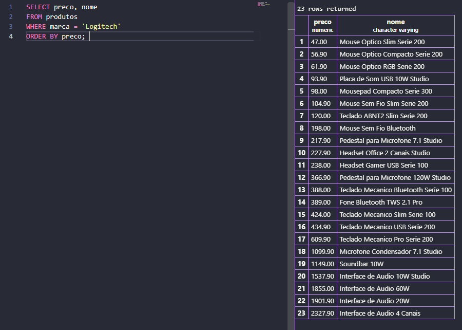
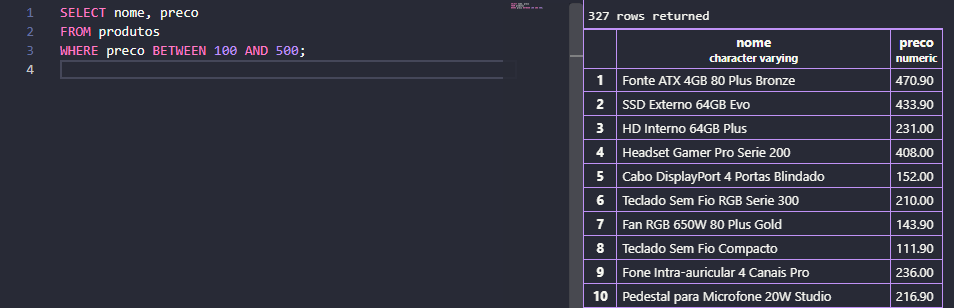
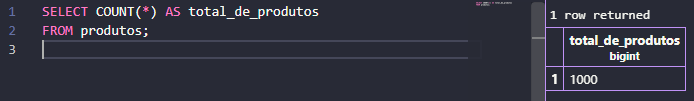
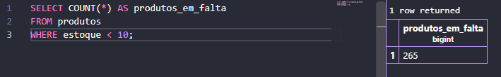
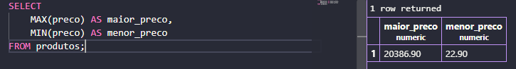
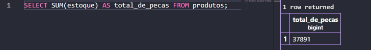
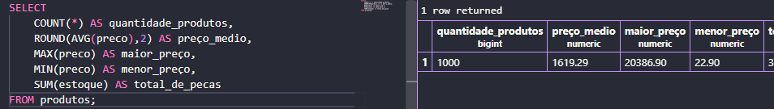
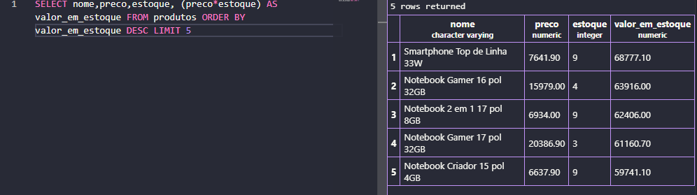

# PARTE A — CONSULTAS E FILTROS

## A1. Liste o nome e o preço de todos os produtos da categoria Monitores.

```sql
SELECT nome, preco
FROM produtos
WHERE categoria = 'Monitores';
```


## A2. Liste todos os produtos com estoque menor que 5 unidades, mostrando nome, categoria e estoque.

```sql
SELECT nome, categoria, estoque
FROM produtos
WHERE estoque < 5;
```


## A3. Liste os 10 produtos mais caros da loja (nome e preço), do mais caro para o mais barato.

```sql
SELECT nome, preco
FROM produtos
ORDER BY preco DESC
LIMIT 10;
```


## A4. Liste os produtos da marca Logitech, ordenados por preço crescente.

```sql
SELECT preco, nome
FROM produtos 
WHERE marca = 'Logitech'
ORDER BY preco;
```


## A5. Liste os produtos com preço entre R$ 100,00 e R$ 500,00, mostrando nome e preço.

```sql
SELECT nome, preco
FROM produtos
WHERE preco BETWEEN 100 AND 500;
```




# PARTE B — FUNÇÕES DE AGREGAÇÃO

## B1. Quantos produtos existem cadastrados na loja? Dê ao resultado o nome total_de_produtos.

```sql
SELECT COUNT(*) AS total_de_produtos
FROM produtos;
```


## B2. Quantos produtos estão com estoque abaixo de 10 unidades? Nomeie a coluna como produtos_em_falta.

```sql
SELECT COUNT(*) AS produtos_em_falta
FROM produtos
WHERE estoque < 10;
```


## B3. Qual o maior e o menor preço da loja? Traga os dois na mesma consulta, com os nomes maior_preco e menor_preco.

```sql
SELECT
    MAX(preco) AS maior_preco,
    MIN(preco) AS menor_preco
FROM produtos;
```


## B4. Qual o preço médio dos produtos da categoria Notebooks, arredondado para 2 casas decimais?

```sql
SELECT ROUND(AVG(preco),2) AS preco_medio_notebooks FROM produtos WHERE categoria = 'Notebooks';
```

## B5. Quantas peças a loja tem no total, somando o estoque de todos os produtos? Nomeie como total_de_pecas.

```sql
SELECT SUM(estoque) AS total_de_pecas FROM produtos;
```



# PARTE C — PAINEL E CÁLCULOS

## C1. Monte um painel resumo em uma única consulta, retornando de uma vez: quantidade de produtos, preço médio (2 casas decimais), maior preço, menor preço e total de peças em estoque. Todas as colunas devem ter nomes compreensíveis para o gerente.

```sql
SELECT 
    COUNT(*) AS quantidade_produtos,
    ROUND(AVG(preco),2) AS preço_medio,
    MAX(preco) AS maior_preço,
    MIN(preco) AS menor_preço,
    SUM(estoque) AS total_de_pecas
FROM produtos;
```


## C2. O valor imobilizado de um produto não está gravado na tabela: ele precisa ser calculado (preço x estoque). Crie a coluna calculada valor_em_estoque e mostre os 5 produtos com maior valor imobilizado, exibindo nome, preço, estoque e o valor calculado.


```sql
SELECT nome,preco,estoque, (preco*estoque) AS valor_em_estoque FROM produtos ORDER BY valor_em_estoque DESC LIMIT 5 
```


## C3. Compare o resultado de C2 com o produto mais caro que apareceu em A3. É o mesmo item? Escreva duas linhas explicando o que essa comparação revela sobre o estoque da loja.

> Não, porque nem sempre o produto com maior valor terá necessariamente o maior faturamento, depende da sua quantidade em estoque.