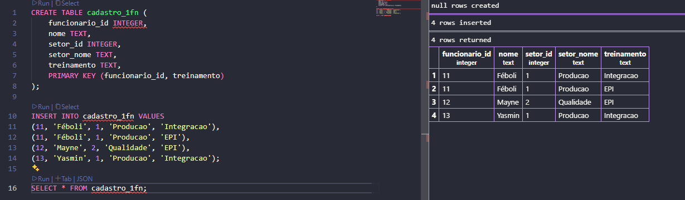
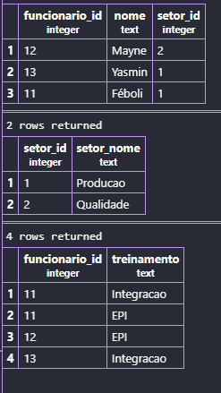

# Banco de Dados Manutec

## Sobre o projeto

Este projeto foi desenvolvido como uma atividade de banco de dados, com o objetivo de organizar o cadastro de funcionários, setores e treinamentos da empresa fictícia Manutec.

A atividade consiste em transformar uma tabela inicial em tabelas organizadas, evitando repetições desnecessárias e facilitando a consulta das informações.

## O que foi feito?

- **1FN:** Separei os treinamentos para que cada linha tivesse apenas um treinamento por funcionário.
- **2FN:** Separei os dados dos funcionários dos registros de participação nos treinamentos.
- **3FN:** Criei uma tabela exclusiva para os setores, evitando repetir seus nomes no cadastro dos funcionários.

## Tabelas criadas

- `cadastro_original`: tabela inicial da atividade.
- `cadastro_1fn`: tabela com os treinamentos separados.
- `funcionarios`: armazena os dados dos funcionários.
- `participacoes`: registra os treinamentos de cada funcionário.
- `setores`: armazena os códigos e nomes dos setores.

### Prints

