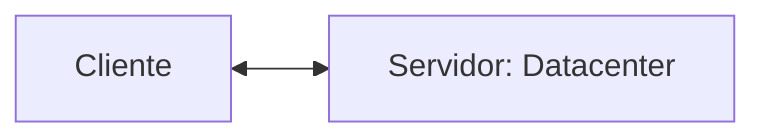

## Servidor de Desenvolvimento
Será uma interface de Desenvolvimento utilizada para projetar aplicações e banco de dados.


---
## Servidor de Arquivos Educacional
É um Servidor para armazenar arquivos e facilitar na hora de realizar transferencia.

>O endereço para acesso ao servidor de arquivos é: `\\10.87.36.10`.

>`Credenciais de acesso: E-mail: aluno, Senha: aluno`

---
## Servidor pessoal
O Moba sera a interface para acesso ao meu Servidor de desenvolvimento.
>O acesso, será realizado via SSH.

## Meu ip
>192.168.10.89

Para o primeiro acesso utilizamos a senha: `aluno01`
Para alterar a senha, utilizamos o comando:
```bash
passwd
``` 

Para visualizar quais serviços estão rodando no meu servidor, utilizamos o comando: 
```bash
htop
```

---
|Recurso|Configuração|
|-------|------------|
|Processador|2 cores|
|RAM|512 MB|
|Armazenamento|6 GB|
|S.O|Ubuntu 26.04 LTS|
---
A ultilização de um servidor de desenvolvimento simula um ambiente real de produção.
 Os objetivos, esperados são:
 - Deploy de projetos,
 - Aplicação de banco de dados,
 - Experiencia real de mercado,

 ## Banco de Dados
 Antigamente, os dados eram salvos em arquivos/planilhas.

 ```mermaid
 graph TD 
 P[Guardar dados]
 -->A[arquivo de texto]
 P[Guardar dados]
 -->B[Banco de dados]

 A -->A1[Um usuario por vez]
 A-->A2[Não possui backup]
 A-->A3[Detalhes importantes ocultos]
 B-->B1[Varios acessos simultaneos]
 B-->B2[Consultas mais eficientes]
 B-->B3[Controle de acesso]
 B-->B4[Backup instantaneo]
 ```

 ---
 >Mas afinal, onde entra o banco de dados em aplicações WEB?

 ```mermaid
 graph LR
 A[Usuario]-->B[Aplicação WEB]-->C[(Banco de dados)]
 ```
 ## SGBD
 Sistema gerenciador de Banco de Dados

 >Função: Gerenciar, Controlar e Permitir consultas nos nossos bancos de dados.

 ```mermaid
 graph TD 
 A[SGBD - PostGreSQL] --> B(Banco de dados)
 A --> C[Armazena usuarios]
 A --> D[Realiza consultas]
 A --> E[Controla acessos]
 ```
 